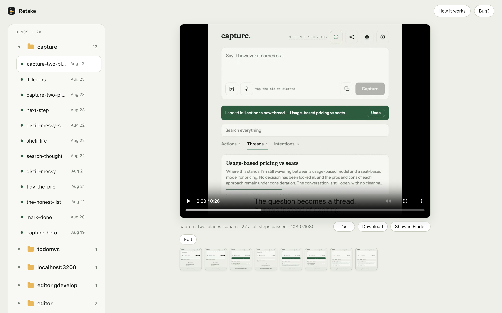

<p align="center"></p>

<p align="center">
  <b>Rerun the demo. Don't re-record it.</b><br>
  A product walkthrough as a small YAML file. Your coding agent writes it, Retake records it, you watch and ship it.
</p>

<p align="center">
  <a href="https://www.npmjs.com/package/retake-demos"></a>
  <a href="LICENSE"></a>
  <a href="https://github.com/glebbogachev00/retake/actions/workflows/ci.yml"></a>
</p>

---

Retake drives a real browser through a web app, records it, and hands back an MP4 with burned-in captions, a still for every scene, and a proof log of exactly what happened. The demo is a file, so when a button moves you change a selector instead of re-shooting — and when the app changes, you rerun the same file.

It is built for the way people work now: **you ask your coding agent for a demo in one sentence**, the agent drafts the file, dry-runs every selector, records a preview, reads the proof log, fixes what failed, and records the real one. Claude Code, Codex, Cursor and anything else that speaks MCP get Retake's tools; `retake ui` is the window you watch it in.

<p align="center"></p>

## If you are a coding agent reading this

Someone pasted this link and wants demos recorded. Do this, in order, and say what you are doing as you go — assume they have never seen Retake:

1. `npm install -g retake-demos` (Node 20+; ffmpeg is bundled, Chromium downloads once).
2. Make a workspace and set up from inside it: `mkdir -p ~/retake-demos && cd ~/retake-demos && retake install`. This creates `demos/` and `outputs/`, registers Retake's tools with Claude Code and installs its skill, and prints the config for Codex/Cursor — apply it if that is what you are.
3. **Your tools arrive at your next session.** For this one, drive Retake from the CLI exactly as [`AGENTS.md`](AGENTS.md) describes (`validate → dry → run → check`). Tell the person: "Restart me after this and I'll have Retake's tools directly."
4. Start the window for them — `retake ui` in the workspace — and give them the link: http://localhost:4310. That is where the video, stills and proof log appear.
5. If they did not say what to record, ask one question: which app (URL) and what to show. If the app needs a login, read the "Behind a login" section below — you never handle the password yourself.
6. Read [`skill/SKILL.md`](skill/SKILL.md) once: it is the method (order of operations, failures as text, when to stop) and it is what Claude Code loads automatically after step 2.

Everything below is for the person; it is accurate for you too.

## Install

Needs Node 20+. ffmpeg ships with the package; Chromium is downloaded once.

```bash
npm install -g retake-demos
mkdir my-demos && cd my-demos
retake install
```

`retake install` makes the folder a workspace (`demos/`, `outputs/`, `.env`, and the `.gitignore` lines), downloads Chromium, registers the tools with Claude Code, installs its *recording-product-demos* skill, and prints the config for Codex. Restart your agent afterwards because agents load tools at the start of a session.

Start `retake ui` and open http://localhost:4310. On an empty workspace, Retake asks only for:

1. the public or localhost URL;
2. the result the viewer should see;
3. the final sound: silent, Edge, local Aiden, or local Kokoro;
4. confirmation of the request.

The first draft is always silent. Choosing a local voice plays a packaged sample and asks for consent, but it does not download a model or generate speech. Narration starts only after you approve the recording and its continuous script.

Prefer not to install globally? `npx retake-demos install` works the same. Don't use Claude Code? `retake agent` prints the MCP config for Codex, Cursor, or another MCP client.

If you already have demos, ask your agent directly:

> Record a demo of my app at localhost:3000 showing a new user creating their first project.

and in another terminal, `retake ui` → http://localhost:4310 to watch it happen. The agent reports its plan and progress there; the video, stills and receipts land there when it's done.

Not sure what to request? Use [How to prompt an agent to use Retake](docs/prompting-retake.md) to choose the recording type, format, voice, music, camera, branding, privacy rules, and delivery checks.

`retake doctor` tells you if anything is missing.

## What you get

```
outputs/<name>/
  demo.mp4        the shareable — captions burned in
  master.mp4      the CRF-14 keeper (post presets only; --no-master skips it,
                  which is ~3x faster on a long take and, because the master
                  path re-encodes an already-encoded file, marginally better)
  stills/         one PNG per scene, mid-scene and at its last moment
  thumbnail.png   the poster — pick any frame, a cover, or your own image in the window
  cover.png       launch mode: the title card, settled
  cover-titled.png launch mode: a real frame with the title over it
  proof-log.md    result, shot list, every step's timing, pass/fail, what was on screen when it failed
  contact.png     launch cuts: one timestamped grid of the whole video (`retake contact`)
  take.json       the raw timeline the renderer reads
```

In the window: play it, switch speed (0.75× to 1.3×, re-rendered in seconds), download, or open its folder — stills, proof log, manifest. **The poster is chosen, not guessed**: scrub to a frame and press *Use this frame*, click any scene still, take one of the generated covers, or upload your own. It rewrites `thumbnail.png`, so it costs no re-render — and on a feed the poster decides whether anyone presses play. Demos group by the app they point at; archive what you're done with.

## The loop

Everything an agent does, you can do from the terminal:

```bash
retake validate demos/x.yaml   # schema + warnings, instant
retake dry demos/x.yaml        # every selector and wait, no camera (~30s)
retake run demos/x.yaml --preset draft   # first take, quarter-size, fast
retake check outputs/x         # resolution, fps, duration, files: pass/fail
retake golden approve finished.mp4 --id short-landscape --title "Short landscape" --approved-by "Your name" --rubric story=pass,framing=pass,timing=pass,text=pass,motion=pass  # interactive human approval
retake golden add finished.mp4 --approval-receipt goldens/.approvals/short-landscape-<hash>.json  # store evidence; never copies the MP4
retake golden verify           # integrity plus the required 5–8 visual families
retake golden score candidate.mp4 --against short-landscape  # cheap deterministic media scorecard
retake verify outputs/x        # did it LOOK right: each scene's `expect`, judged (exit 3 on failure)
retake run demos/x.yaml --brisk  # the steps without the pacing — for iterating, not for keeping
retake intent                 # what your product IS — context every visual check needs
retake sweep outputs/x        # every frame as a whole: the ten ways a picture can be wrong
retake flag demos/x.yaml --scene s --expect "…"   # this one is real — watch it from now on
retake fixed x                # did what you flagged get fixed, with the clip that shows it
retake heal                   # demo files back for recordings whose manifest went missing
retake sense outputs/x        # does the run ADD UP — what went in against what came out
retake destroy demos/x.yaml   # the flows nobody wrote down: nine ways to abuse this demo
retake notes                  # read every take back: what keeps going wrong, and what it costs
retake run demos/x.yaml        # the real one
retake render outputs/x        # captions/camera/speed changed? re-render, no browser
```

The expensive step comes last on purpose. `dry` catches most failures in seconds and prints the step, the error, and the text that was on screen; a failed `run` costs a minute and a confusing video. When a step fails during `run`, Retake stops, keeps what it has, and the proof log says which step and why — an agent fixes it from that text, never from watching the video.

Exit codes: `0` good · `2` a step failed or the video is a raw fallback · `3` `dry`/`check` failed.

To join separate recordings, use [`retake stitch`](docs/stitch.md). Supply existing output folders or video files, a new MP4 path, and one transition style.

## The recording environment — what has to be true before the camera

Six takes in one session were lost to the environment and not one to the
recorder: an app pointed at the owner's real cloud store, a browser tab still
attached that pushed the owner's board back into the "isolated" instance, a dev
server caching its board so the seed only applied at boot, and two runs racing
one output folder. Every one is cheap to assert and expensive to read off a
frame.

```bash
retake env up        # restart it clean, clear its state, then PROVE it
retake env check     # prove the running one without restarting
retake env down
```

`demos/environment.yaml` declares it:

```yaml
name: capture-local
start:
  command: npm run dev -- --port 3179
  cwd: ~/capture-local
  port: 3179
  env:
    # Blanked, not unset: .env files are read AFTER the process environment,
    # so "" is what stops a real token reaching a real account.
    UPSTASH_REDIS_REST_URL: ""
    APP_PASSWORD: ""
reset:
  restart: true            # the app caches state; without this, take two
  clear: [".retake/sync"]  # inherits whatever take one left behind
expect:
  path: /app
  present: ["button.tab:has-text('Intentions')"]
  absent:  ["text=a real note of mine"]   # name what must NOT be there
```

`absent` is the one that earns its place. A present-only check cannot see real
data leaking in, and you cannot assert the absence of something you did not
think of — so name it. `retake routine run` picks the file up automatically and
**refuses to record** if the environment is not what it claims.

## Routines — the settings nobody should decide twice

`demos/style.md` is taste an agent reads while drafting, so every draft is a
fresh interpretation of it. That is how one video comes back narrated too fast,
the next too slow, and a third in a voice nobody asked for.

A routine is the other half: format, captions, voice, speaking rate and music
held as data and **stamped onto the manifest after it is drafted**. The model
writes the story; the routine writes the settings; they never argue.

**A new product in one step.** Point at the app and at one video you love:

```bash
retake routine setup http://localhost:3000/app --like "~/Videos/the-one-we-liked.mp4"
```

Everything that can be read off those two arrives decided: the shape, the
cards and their colours from the video; the brand's mark from the page; an
environment that starts your app on its own port with every token in `.env`
blanked (names only — a value never leaves its file); and a brief with the
selectors on the first screen, so the next agent starts informed. What cannot
be read — the closing card's words, the one real thing that must never appear —
is asked once, at the end. A live site works too; there is just nothing to start.

**Start by reading, not by guessing.** The first routine used to be Retake's
defaults — an opinion wearing the clothes of a standard, which `apply` then
stamps over everything with confidence. Read it off demos you already shipped:

```bash
retake routine learn                 # what your existing manifests actually agree on
retake routine learn --write         # make that the standard
```

It reports what did *not* agree rather than quietly picking, so a split shows up
as a question instead of a silent decision.

```bash
retake routine init                  # or start from Retake's defaults instead
retake routine voices                # hear the named voices once, then stop discussing speed
retake routine set voice neutral
retake routine set rate -8           # too fast, once, for every video that follows
retake routine                       # what every recording here will look and sound like
```

Three styles, because a style is a shape and not a theme:

| Style | Output | Captions |
|---|---|---|
| `showcase` | 1920×1080 | the app inset on your own colour, with a shadow |
| `fullscreen` | 1920×1080 | the app fills the frame, nothing around it |
| `mobile` | 1080×1920 | inset the same way, for shorts and reels |

**Proving they match.** A standard nobody measures is a hope.

```bash
retake routine check          # measures the finished files, not the manifests
```

It reads back size, frame rate, whether there is a voice and how loud it is, and
judges each video against the standard *and* against the others — because two
videos can agree with each other and both be wrong (a batch whose final render
failed leaves matching previews at the wrong frame rate).

Three things it cannot see, which the earlier steps catch instead: a key Retake
does not know (strict manifests reject it), a script copied from another demo
(`validate` compares the narration against that demo's own captions), and data
the app repopulated mid-take (stub the sync so nothing outside the demo can
change what is on screen).

**Start from a north star.** One approved video that every cut is held to:

```bash
retake routine reference "~/Videos/the-one-we-liked.mp4"
```

Before anything records, it says what this routine cannot reproduce — "the
reference is narrated, the routine is silent", "the routine uses Retake's own
card, not a branded one" — so a take is never the thing that discovers it.
After, `retake routine check` scores each cut against it: the opening card, the
closing card and the frame around the app, as structural similarity, plus
size, frame rate and how loud the voice is.

Two pieces exist so a north star *can* be reproduced: a branded `card` (the
product's mark, typeface, ground, ink and corner circles, drawn by Retake
instead of added afterwards), and narration with `align: scenes` — the script
read once so it sounds like a person, then each paragraph placed on its
narrated scene. A line that would run into the next scene is reported, never
sped up.

**Recording a batch.** `demos/plan.json` is the queue — names and one-sentence
stories, written by whoever has the ideas. A routine never invents one.

```bash
retake routine run              # everything not done yet
retake routine run -n 3         # three videos, then stop
retake routine run --only hero  # re-record one
```

**Letting it run itself.** Once a routine has a plan and a north star, nobody
needs to be at the keyboard:

```bash
retake routine schedule weekdays 09:00   # the next drafted video, every weekday morning
retake routine schedule                  # what is scheduled, and whether the machine holds it
retake routine schedule off
```

Each run brings the app up isolated, records one video, judges it against the
north star and delivers it only if it matches — then a notification says how
it went. launchd wakes it on a Mac, cron on Linux; nothing of Retake's stays
running. A story with no manifest yet waits instead of failing, so an
undrafted idea never costs a morning.

Each item is stamped, dry-run, recorded as a preview and finished at full
quality, with progress written to `plan.json` as it goes — so an interrupted
batch resumes where it stopped, and one broken selector does not cost the other
four videos. Two failures in a row stops the batch and asks whether the app is
actually running.

**Two standards, two products.** `retake routine new techtutor-vn`, then
`retake routine set voice vi-VN-HoaiMyNeural --as techtutor-vn`. The language
rides on the voice, so there is no second setting that could disagree with the
first. `retake routine use <name>` switches; `--as <name>` is a one-off.

**What a routine will not do:** turn narration on. That needs a script and a
person who has heard it — the routine only says which voice reads it, and how
fast, once somebody has written one.

## Demo-as-code

```yaml
name: first-project
title: "Creating your first project"
url: http://localhost:3000
preset: post-landscape            # `retake presets` — 1920×1080 page + caption band
viewport: { width: 1440, height: 1080 }
scale: 1.8                        # page drawn at 1.8× so text stays crisp
reducedMotion: true
camera: static                    # still (the default); `auto` eases toward the last thing touched

seed: []                          # put the app in a known state first
setup: []                         # runs before the camera; trimmed off the video

steps:
  - { action: scene, label: start, caption: "An empty workspace.", camera: static }
  - { action: wait, ms: 1500 }
  - { action: click, selector: "button:has-text('New project')", pauseAfter: 800 }
  - { action: type, selector: "input[name=title]", text: "Q3 launch plan", delay: 40 }
  - { action: click, selector: "button[type=submit]" }
  - { action: waitFor, selector: ".project-header" }
  - { action: scene, label: result, caption: "And it exists." }
  - { action: wait, ms: 2500 }

outputs:
  thumbnail: { scene: result }
```

On a new workspace, `retake ui` opens the first-demo flow and writes the manifest from your answers.

**Steps** — `click`, `type`, `fill`, `select`, `hover`, `drag`, `scroll`, `keyboard`, `navigate`, `wait`, `waitFor`, `evaluate`, `upload`, `download`, `screenshot`, `scene`. Every step takes `pauseAfter`, `waitFor`, `timeout`, `secret`. Targets are a selector, or a point — `{x, y}` or `{selector, dx, dy}` — for canvases and SVG editors. `${VAR}` expands from `.env` and fails loudly when unset.

**Waits** take three modifiers, because a bare selector resolves the moment the element exists: `gone: true` waits for it to leave (the previous action's banner), `minChars: 40` waits for it to hold real text (a streamed reply), `stableMs: 500` waits for its subtree to stop changing.

**Scenes** are the spine: `{ action: scene, label, caption }` at each beat. They take their timestamps from the actual run, so captions land on the frames they describe even when the app took 3 seconds this time and 11 the last. **Labels must be unique** — `thumbnail`, `until`, the stills and the proof log all address scenes by label, so two scenes called the same thing make every one of those ambiguous. `validate` rejects it.

**Two kinds of take.** `mode: demo` (the default) proves how something works — a client walkthrough, a PR clip, a lesson — and keeps everything but the product out of the frame. `mode: launch` presents the product in public and may carry a title card, music, emphasis and a branded ending. `validate` warns if a demo is carrying launch furniture. **The launch cut.** `compressIdle: true` shows the app's long waits as ~1.5 s each (your own pacing `wait`s are never touched); `voiceover: true` reads the captions aloud (edge-tts, `pipx install edge-tts` once). **Local voices** run on an Apple Silicon Mac and send nothing anywhere: `retake routine set voice heart` (Kokoro, female, ~300 MB), `michael` (Kokoro, male) or `aiden` (Qwen3, ~1.8 GB). They need [uv](https://docs.astral.sh/uv/) (`brew install uv`); the model downloads once, the first time a video is narrated. Kokoro reads demo words the demo way ("press re-CORD", "deh-mohz") and every local voice is levelled to Edge's loudness; `typing: brisk` makes typed text land fast with the pauses carrying the meaning. All render-time except typing. **Music.** `music: track.mp3` (or `{ file, gainDb, fadeOutMs }`) mixes a bed under the video at render time, looped or trimmed to fit and faded out at the end. Bring your own track — it ships inside your video, so it must be one you may use (CC0 or licensed). **Cards and callouts.** `intro:`/`outro:` add a title card in Retake's own look — rendered at render time, so changing a word is a re-render, and the intro's settled frame is written as `cover.png`, the poster. `{ action: callout, selector, label, ms }` draws an animated ring and label around an element while the take holds — recorded coordinates, drawn at render, moving with the camera. Sparingly: the captions carry the story.

**Seeds** put the app in a known state before the camera: write a JSON file, run JS in the page, or run a shell command. **Setup** is the stuff that runs before recording and is trimmed off the front — logins live there. **`tempo`** speeds the finished video up or down at render time; **`lock`** names a shared resource so two demos that touch the same backend don't record over each other.

## Quality

Think in the publishing format, not the browser window.

| Preset | Video | Page area | For |
|---|---:|---:|---|
| `draft` | 960×540 | 960×464 | iterating — the finals' layout at a quarter of the pixels, fastest |
| `preview-fast` | 1920×1080 | 1920×930 | checking timing and framing, hardware-encoded |
| `post-landscape` *(default)* | 1920×1080 | 1920×930 | the general-purpose demo, plus a CRF-14 master |
| `post-square` | 1080×1080 | 1080×960 | feeds |
| `post-vertical` | 1080×1920 | 1080×1800 | shorts and reels |
| `docs-gif` | 1440×900 | 1440×800 | README and docs GIFs |
| `master` | 1920×1080 | 1920×930 | archive, CRF 12 |

**One preset, one size — and size is not recorded.** The caption band sits inside the canvas, so `post-landscape` is always exactly 1920×1080 and two demos of the same app are never different shapes. Better still, the shape is decided at render: the take is fitted into whichever canvas you ask for, so `retake render outputs/x --preset post-vertical` gives you a 9:16 cut of a demo you recorded landscape — seconds, no browser, no re-record. Setting `viewport` in a manifest overrides the page and `validate` warns, because that is how one demo ends up a different shape from the rest.

**Page scale** is what makes it crisp: the page lays out as if the viewport were smaller and every glyph is drawn at 2×, so 1080p text reads on a phone. **Camera** is still by default — a calm demo reads as real. `camera: auto` eases toward whatever the demo just touched, at render time, clamped so it can never crop the thing it points at; per scene: `camera: { focus: ".result", zoom: 1.3 }`. Zoom is something you ask for after seeing a take, not something that happens to you. Captions, camera, speed, trim, format and layout are all render-time: change them and `retake render` takes seconds, never touches the browser.

## Behind a login

Most real demos start on the far side of a sign-in. You never put a password anywhere an agent can read it.

**Save a login once per site.** When the agent sees the app needs a login, a small form appears in the window: *Sign in to app.example.com*. Type a demo account's username and password; Retake keeps them in your Mac's Keychain (the system keyring on Linux), never in a file the agent can read, and never sends them anywhere. Every demo of that site — in any workspace — signs in with it from then on, and signs in again by itself whenever its session runs out.

**Without the window**, the agent relays one line — run it and type the login (hidden):

```bash
retake login https://app.example.com
```

`retake logins` lists the sites with a saved login (names only); `retake login <url> --forget` removes one.

**Then:** the login runs *before the camera* and is trimmed off the front; the video starts signed in. The session is saved to `.auth/`, so later takes skip the login. A wrong password stops the take instead of recording a logged-out one.

**Two-factor.** If the site asks for an authenticator code, choose *It asks for a code* and paste the setup key; Retake computes the current code when it fills the field. SMS codes, SSO, captchas — anything only a person can do — choose *Sign in by hand*: a real browser opens, you sign in, press Done, and Retake keeps the session (not the password). From a terminal: `retake login <url> --by-hand`.

What the agent writes:

```yaml
auth:
  storageState: ../.auth/app.example.com.json   # the site's session, reused until stale
  setup:
    - { action: fill, selector: "#user", text: "${LOGIN_USER}", secret: true }
    - { action: fill, selector: "#password", text: "${LOGIN_PASSWORD}", secret: true }
    - { action: fill, selector: "#code", text: "${TOTP:LOGIN_TOTP}", secret: true }   # only if asked
    - { action: click, selector: "button[type=submit]" }
```

A value of the same name in the workspace `.env` still wins, so demos written with `${APP_USER}`-style names and `retake secret` keep working.

`secret: true` keeps a value out of the terminal, the window and the proof log — but not out of the video, which is why `validate` warns when a secret step is in `steps` rather than `auth.setup`. Use a demo account: the output is a video you may publish. Apps that keep their session in IndexedDB (Firebase) can't be restored from a saved session; put the login under plain `setup` instead.

## Limits worth knowing

- **One page.** Retake records one tab. `keepInTab` (on by default) folds `window.open` and `target="_blank"` back into it, so popup logins and "preview" buttons stay on camera; flows that genuinely need a second window do not.
- **~180 cursor moves per take.** Retake flattens testreel's cursor expressions at install time (the stock ones hit ffmpeg's nesting limit at ~45 moves); the remaining ceiling is the filter's size as one process argument. `validate` warns, the recorder detects it, `check` fails. Long stories still want chapters of 30–45 seconds — for the viewer, not the tool.
- **macOS is where it's used daily.** `videotoolbox` hardware encoding falls back to libx264 elsewhere; Linux is untested beyond CI.

## How it's built

```
src/
  cli.ts          install · init · doctor · ui · run · dry · render · check · validate · describe · ideas
  manifest.ts     zod schema, presets, warnings
  record.ts       Playwright + testreel → take.json (seeds, auth, locks, stop-on-fail, drag)
  dryrun.ts       every selector and wait, no camera
  render.ts       ffmpeg: camera → layout → captions → demo/master, stills, check
  edits.ts        structural edits agents make to a manifest (comments preserved)
  operator/       the MCP server: 22 tools, from `scout` and `draft` to `run`, `look` and `done`
  ui/             one http server, three pages, no framework, no build step
skill/SKILL.md    what the agent is taught: order of operations, failures as text, when to stop
demos/            manifests; outputs/ is where takes land
```

Recording and the cursor come from [testreel](https://github.com/greentfrapp/testreel); GIFs from [gifski](https://github.com/ImageOptim/gifski) when installed; ffmpeg from `ffmpeg-static`. Retake adds what the job needs on top: waiting on selectors, seeds, scenes with real timestamps, camera and captions at render time, presets, credentials, locks, structural edits, and the receipts.

## Developing

```bash
git clone https://github.com/glebbogachev00/retake && cd retake
npm install                      # also builds dist/
npx playwright install chromium
npm run retake -- run demos/todo-basics.yaml --preset draft   # a public app, no setup
npm test && npm run typecheck
```

`npm run retake -- …` runs the TypeScript source; `retake …` is the built package — same code. See [CONTRIBUTING.md](CONTRIBUTING.md), [BACKLOG.md](BACKLOG.md), and [AGENTS.md](AGENTS.md) (what coding agents read when pointed at this folder). Found something off? The **Bug?** button in the window pre-fills an issue with the receipts.

## License

[MIT](LICENSE) — Gleb Bogachev.
